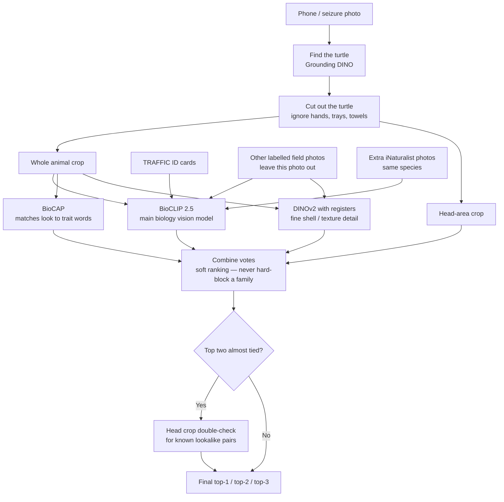

# Offline high-accuracy ID stack

Plain-language and technical notes on the batch identification path built in October 2026. This is separate from the Streamlit YOLOv8 training path: it runs locally with foundation models and does not need a trained TurtleID classifier.

## What it is for

Given a folder of seizure / field phone photos, produce a ranked species shortlist for each image, then compare to known labels. Designed for accuracy over speed (a few minutes per batch is fine).

## Pipeline (simple English)



| Piece | Job |
|-------|-----|
| Grounding DINO (`IDEA-Research/grounding-dino-tiny`) | Find where the turtle is in the frame |
| BioCLIP 2.5 (`imageomics/bioclip-2.5-vith14`) | Main species similarity brain |
| BioCAP (`imageomics/biocap`) | Trait-style text (“red ear”, “soft shell”, “yellow head spots”) |
| DINOv2 registers large | Extra visual detail for sisters / softshells |
| TRAFFIC plates | Official reference cards (low weight vs field photos) |
| Leave-one-out field gallery + iNat | Real examples of each species without using the query’s own label |
| Combiner (Tip-Adapter, CL2N, soft family/genus prior, logistic probe) | Merge scores; **no hard taxonomy gate** (that caused regressions) |
| Head specialist | Only when top-2 margin is tiny and the pair is a known confusion |

## Code map

| Path | Role |
|------|------|
| `core/photo_match.py` | BioCLIP / OpenCLIP loader and embeddings |
| `core/foreground.py` | Border-based animal crop (fallback) |
| `core/stack_v2/` | Crops, Tip-Adapter scoring, iNat gallery, traits, seizure groups |
| `core/taxonomy_gate.py` | Older hard-gate groups (used by v1 stack script; **not** used as a hard mask in v2) |
| `scripts/score_turtles_v2.py` | Full v2 blind run + compare |
| `scripts/score_turtles_stack.py` | Earlier crop + hard gate + LOO stack |
| `scripts/score_drive_batch.py` | BioCLIP-only batch over `Turtles/` |
| `requirements-matcher.txt` | Extra deps for the matcher stack |

## How to run

Weights download into `models/hf_cache/` on this volume (see [model-cache.md](model-cache.md)).

```bash
source .venv/bin/activate
python -m pip install -r requirements-matcher.txt
# Put photos in Turtles/ (gitignored)
python -m scripts.score_turtles_v2 --compare
```

Outputs (local only, gitignored): `logs/turtles_v2.csv`, `logs/turtles_v2_vs_truth.csv`.

## Design decisions we locked in

1. **Vision shortlists; features / humans decide sisters** — see [feature-rule-engine.md](feature-rule-engine.md).
2. **No hard family gate** — 22/38 errors on the v1 stack were gate misses; ungated BioCLIP alone was right on 12 photos the hard gate broke.
3. **Do not use SpeciesNet as the species classifier** for Indian freshwater turtles (taxonomy almost never has our taxa).
4. **Do not fine-tune ViT end-to-end on ~92 photos** — frozen backbones + Tip-Adapter / linear probe only.
5. **Keep plates separate and low-weight** vs field / iNat prototypes.
